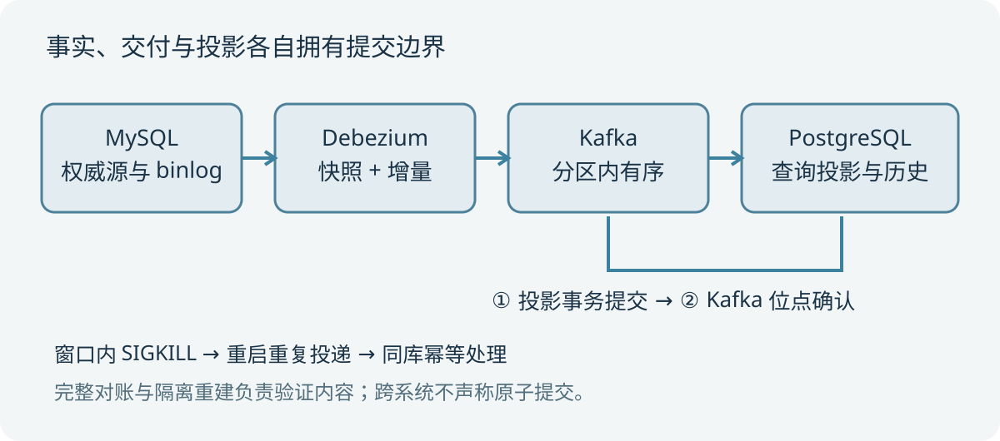

# 第1章 同步契约：先定义副本代表什么

## 从一次搜索投诉开始

商品价格已经在管理后台改成七百七十七分，搜索页却仍显示旧值。值班者看到连接器状态正常、Kafka 有流量、消费者也没有报错，仍然不知道问题在哪里。这不是缺少一个更大的监控面板，而是系统没有把正确性拆成可以检验的契约。源表写入成功只说明 MySQL 接受了事务；连接器正常只说明任务当前在运行；消费位点前进也不能单独证明查询对象已经更新。

我们的第一个契约是身份。商品由主键 id 唯一标识，sku 是可变化属性，不能同时把它当成投影永久身份。第二个契约是内容：投影保存 id、sku、price_cents、active、revision，后续演进增加可空 note。价格用整数分，避免对账时把浮点表示误差误判成同步失败。第三个契约是删除：源表物理删除后，在线查询不能返回该商品；投影内部可以保留删除标记用于阻止旧事件复活。

## 把时间分成不同边界

源库事务提交、连接器读取日志、Kafka 接收记录、消费者提交投影、消费者提交位点是五个不同的时刻。把它们统称为“同步完成”会掩盖故障窗口。业务接口若需要读到刚写入的值，可以返回源库确认，或者等待一个明确的投影水位；仅等待固定两秒不能提供读己之写保证。本文实验最终停止写入并完整对账，证明该批有限变更已收敛，不能把这个结果表述成持续写入时的线性一致查询。

我们把可接受的数据延迟看成服务目标，把最终内容一致看成正确性目标。延迟高可能仍然正确，内容错误即使非常快也不能接受。例如消费者把 price_cents 当成元展示，所有消息都会成功处理，却破坏业务语义。再如删除事件被过滤，插入和修改都正常，查询副本仍保留已经不存在的商品。正确性必须覆盖操作种类和字段语义，而不是只统计消费数量。

## 投影不是第二个事实源

MySQL 是本书商品事实的唯一写入入口。投影数据库由同步程序维护，业务界面不能直接修改它再期待变化反向传播。否则两个存储都能产生事实，需要冲突检测、来源标识和优先级规则，这已经是双向同步问题。我们刻意维持单向链路，使重建能从源库出发得到确定结果。

这种选择也决定恢复方式：损坏的查询投影可以丢弃并重建，源库不能因为投影异常而被反向覆盖。删除标记、消费历史和检查点属于投影的恢复元数据，并不是新增的业务事实。它们可以帮助判断哪些事件已经应用，却不能单独恢复被源库与日志共同丢失的业务变更。因此可重建不等于免备份，日志保留也不等于完整灾备。

## 正确性检查需要覆盖什么

在实验里，对账按照主键排序读取源表全部行，读取投影里所有未删除行，比较完整 JSON 字段和值。我们同时记录行数和规范序列化后的摘要，但通过条件是实际列表相等。仅行数相同无法排除一行缺失、一行重复；仅抽样主键无法排除价格错位；仅比较最大 revision 无法排除中间对象丢失。小数据允许完整比较，生产中可以分桶与分段执行相同逻辑。

正确性还包括变更期间的行为。新字段上线时，旧对象没有收到更新事件，投影也必须有明确的默认值语义。删除后的旧事件重放不能复活对象。消费者崩溃后，重放不能重复扣款之类的业务副作用。本书投影只更新查询文档，不执行支付操作；若读者把消费者改成外部命令处理器，需要重新建立业务幂等协议，不能只复用当前表结构。

## 把失败语义写进接口

查询接口也应当告诉使用者数据可能落后，而不是在后台积压时继续展示毫无上下文的旧值。对于普通商品目录，可以接受短暂延迟并保留源库管理入口；对于余额、库存扣减或访问许可，延迟副本可能不足以作最终决策。同步架构应由业务风险决定读取路径，不能先搭好流式管线再让所有接口迁入。契约还应明确字段来源：哪些值来自权威表，哪些是投影计算，哪些只是展示缓存。否则对账发现差异时，团队会争论究竟该修源还是修副本。

## 本章练习

给一份用户目录定义同步契约，至少写出身份字段、可变字段、删除含义、可接受延迟和对账方法。再回答：用户禁用与物理删除是否相同？如果查询系统承担权限过滤，延迟期间是否允许继续展示旧结果？这两个问题的答案会直接影响后续事件模型和读取策略。
